# MedFlow

A healthcare operations dashboard for managing patients, admissions, doctors, laboratory orders, billing, pharmacy and appointments, built as a browser-only React application.

**[Try it online →](https://med-flow-amber.vercel.app)**

|                                                            |                                             |                                                 |
| ---------------------------------------------------------- | ------------------------------------------- | ----------------------------------------------- |
| **Dashboard**                                              | **Themes**                                  | **Localization**                                |
| 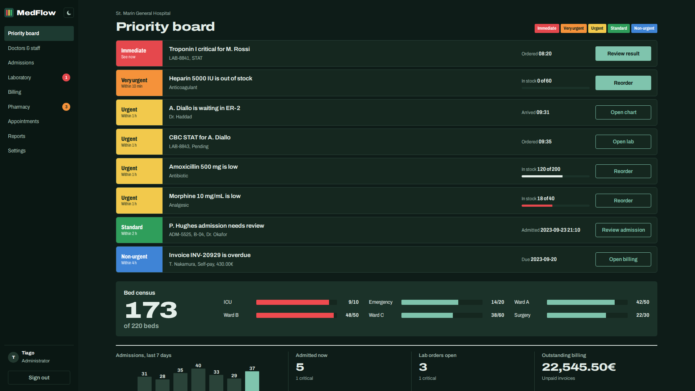                   | 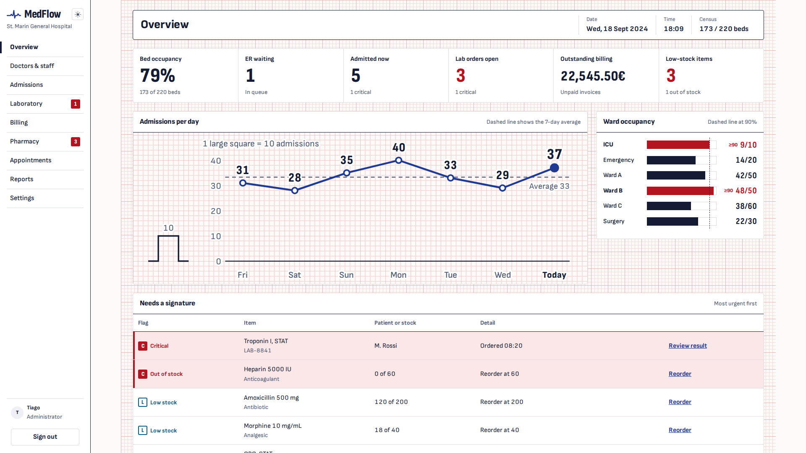 | 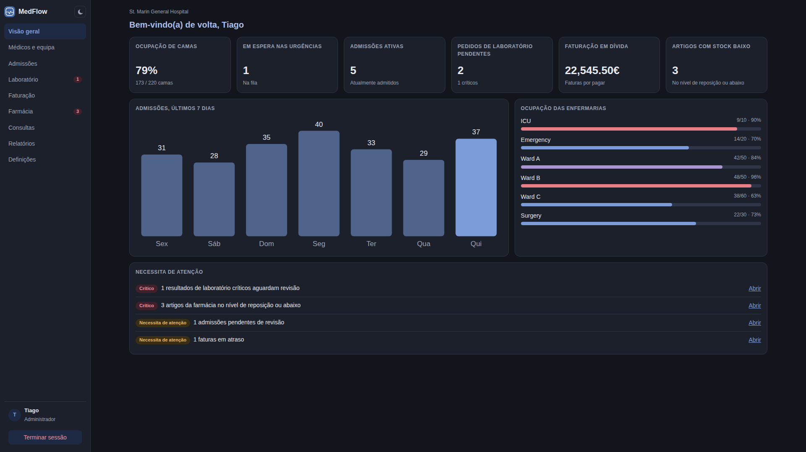 |
| **Staff**                                                  | **Admissions**                              | **Laboratory**                                  |
| 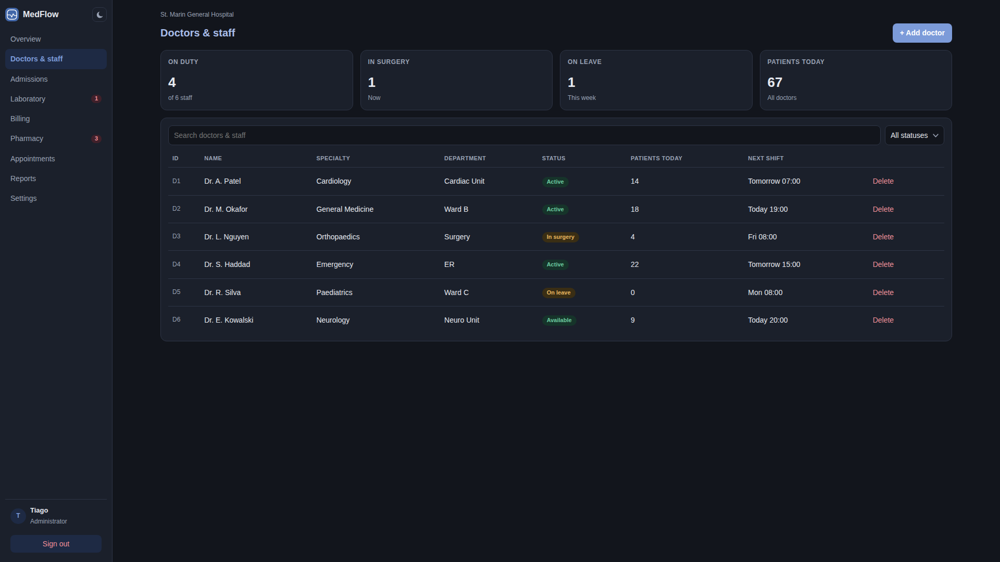                        | 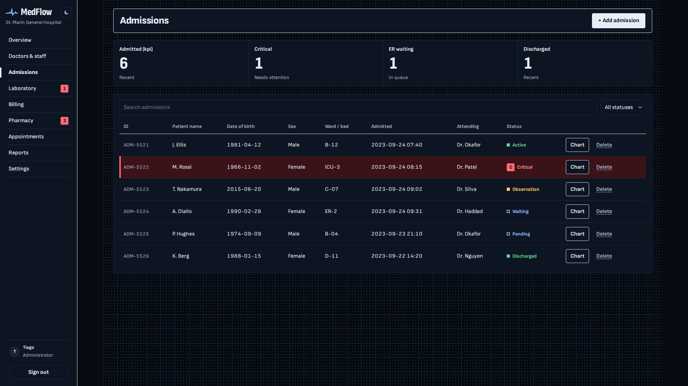 | 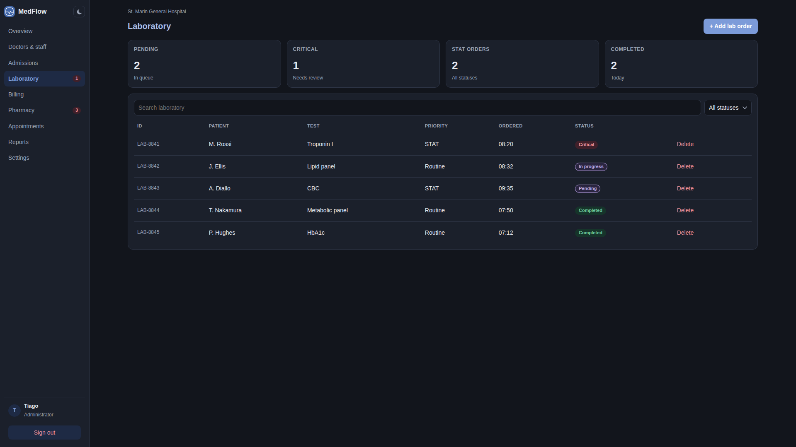     |
| **Billing**                                                | **Pharmacy**                                | **Appointments**                                |
| 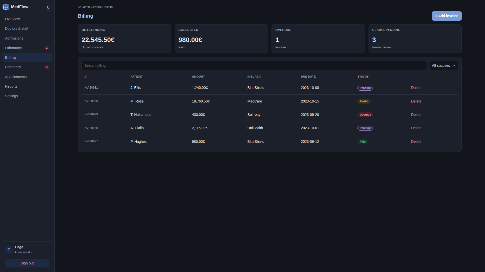                      | 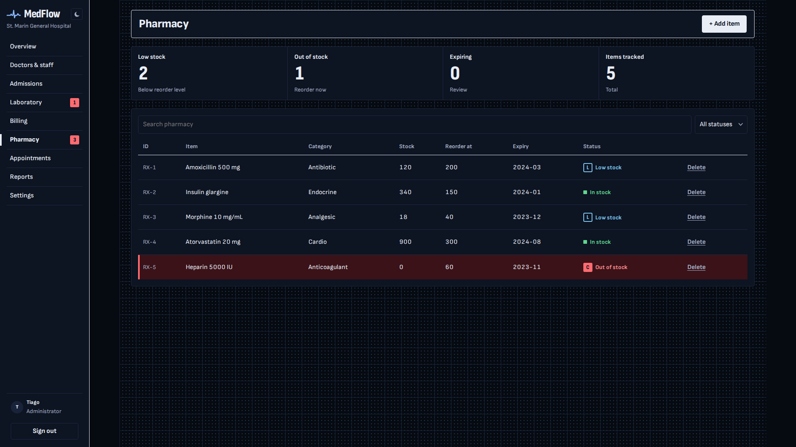     | 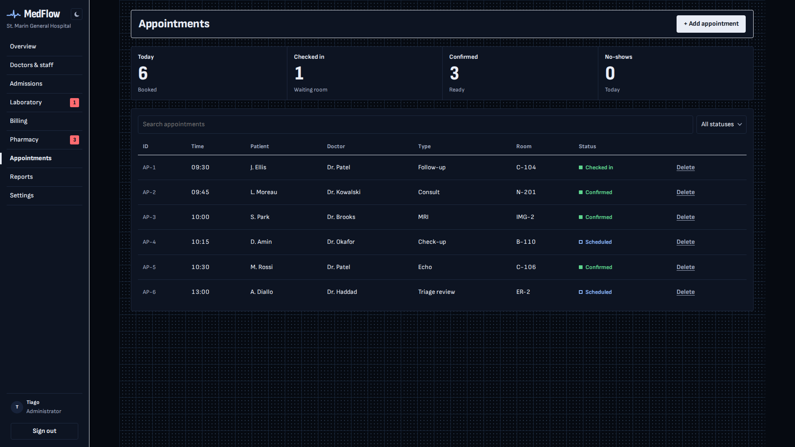 |
| **Patient Charts**                                         | **Reports**                                 | **Settings**                                    |
| 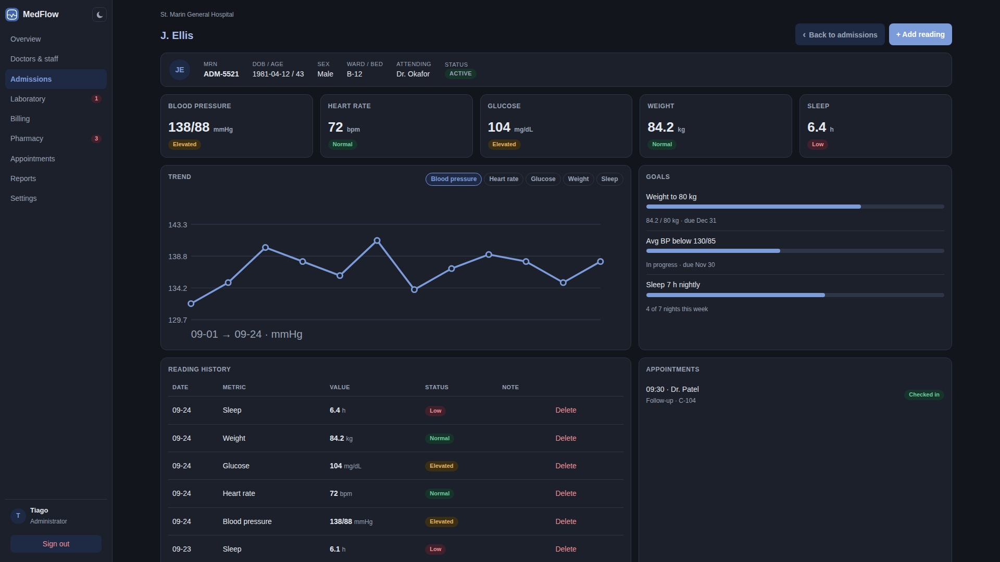 | 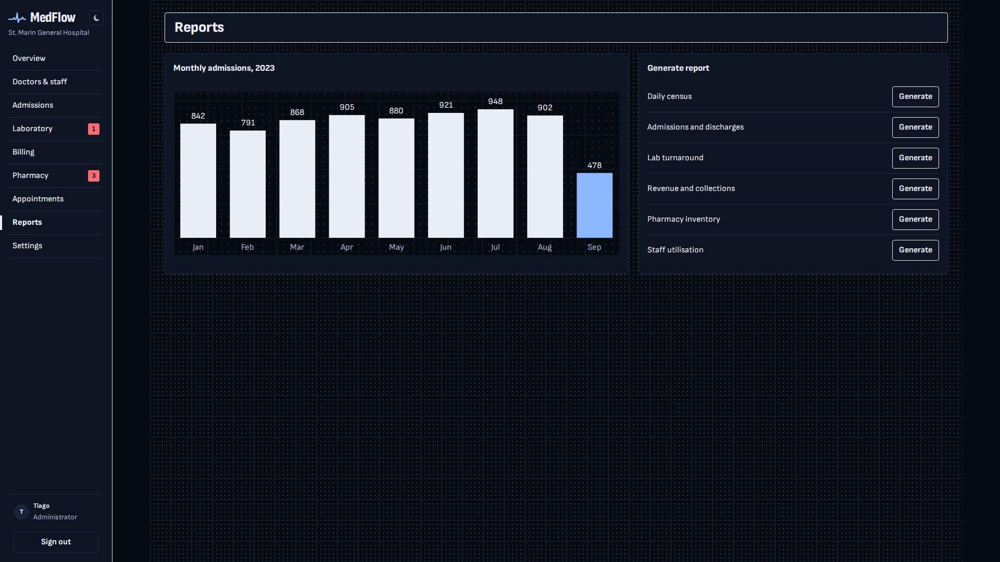       | 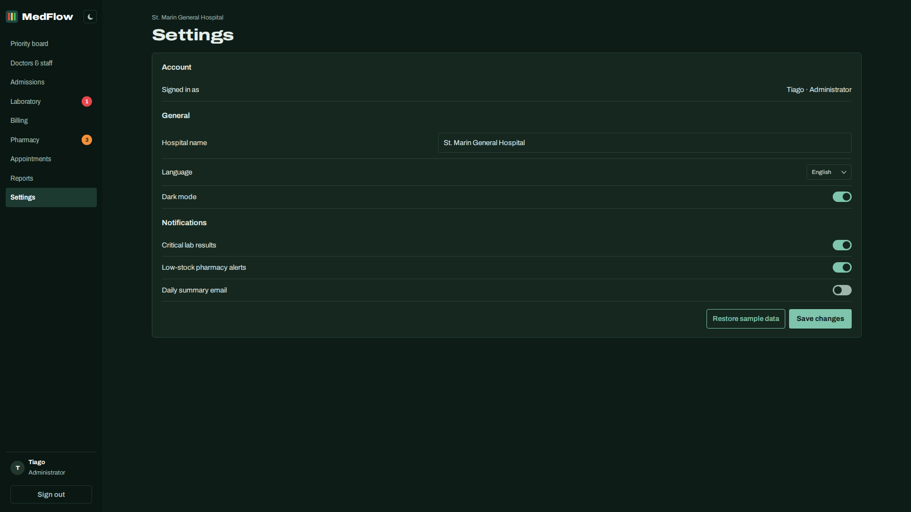         |
|                                                            | **Authentication**                          |                                                 |
|                                                            | 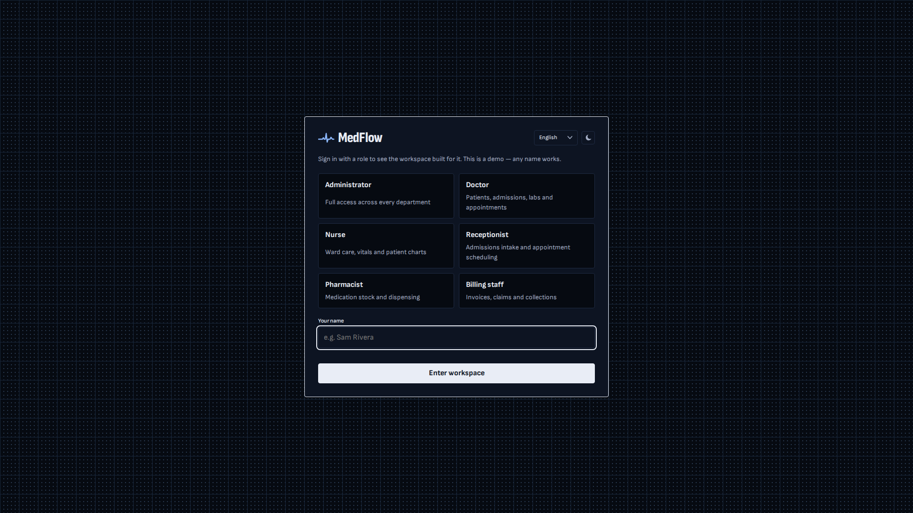  |                                                 |

## Features

- **Overview dashboard:** hospital-wide KPIs, admissions and ward occupancy charts, and a list of items needing attention.
- **Resource management:** search, filter, add, edit, view and delete doctors, admissions, laboratory orders, invoices, medications and appointments.
- **Patient charts:** patient details, vitals with trends and reading history, goals and appointments for each admission.
- **Role-based access:** six roles, chosen at sign-in, each with its own navigation and permitted routes.
- **Reports:** generated from the application's data, with CSV export and a print-friendly view.
- **Localization:** English, Portuguese, Spanish and French across navigation, forms and statuses.
- **Themes and settings:** dark and light themes, language, hospital name and notification preferences.
- **Responsive layout:** a mobile navigation drawer and layouts that adapt across screen sizes.
- **Animations:** page transitions, modal animations and KPI counters.

## Stack

React 18 and TypeScript, built with Vite, with React Router for routing and Framer Motion for animation. There is no backend: data is seeded in the browser and kept in `localStorage`.

## Engineering highlights

- **Configuration-driven resources:** one resource page, table and form serve all six resources from a single configuration in `src/features/resources/resourceConfig.ts`.
- **One permission source:** each role's permitted pages are listed in `src/features/auth/roles.ts`, and both the navigation and the route guards read from them.
- **Translations that leave data alone:** dictionary lookups happen at display time, so stored status values stay the same in every language and filtering keeps working.
- **Charts without a chart library:** the line and bar charts in `src/components/charts/` are hand-written SVG and CSS.

## Run it

Requires Node.js 20.19+ or 22.12+.

```bash
npm install
npm run dev
```

| Command                | What it does                                   |
| ---------------------- | ---------------------------------------------- |
| `npm run dev`          | Start the development server                   |
| `npm run build`        | Typecheck and build for production into `dist` |
| `npm run preview`      | Serve the production build locally             |
| `npm run lint`         | Run ESLint (`npm run lint:fix` to fix)         |
| `npm run format:check` | Check formatting (`npm run format` to fix)     |

## Documentation

- [Architecture](docs/ARCHITECTURE.md): how the application is structured, its data and state, and its trust boundaries.
- [Deployment](docs/DEPLOYMENT.md): configuration, first deploy and release checks.

## Licence and credits

Released under the [MIT License](LICENSE). The interface uses [Sofia Sans and Sofia Sans Condensed](https://fonts.google.com/specimen/Sofia+Sans) by Lettersoup, served by Google Fonts under the SIL Open Font License.
